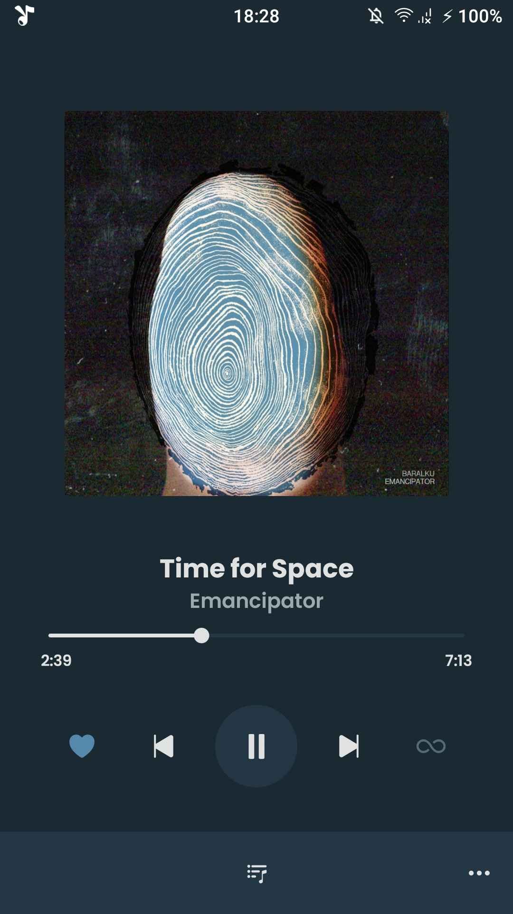
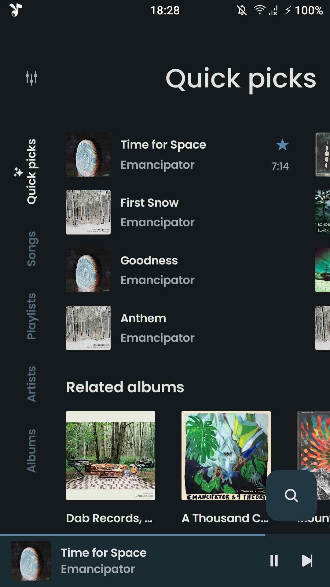
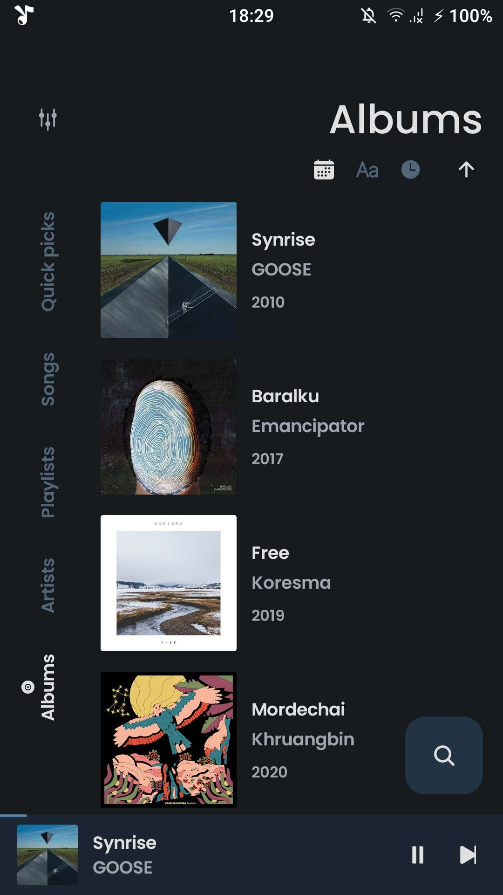

  
  <h1>Dhun</h1>
  
<strong>Har gaane mein ek kahaani.</strong>

  
An independent, open-source Android music player.

## Download

Download the latest Android APK: **[Dhun.apk](https://github.com/polikeybhuvan/Dhun/releases/latest/download/Dhun.apk)**

On your phone, open the downloaded APK and allow installation from your browser or file manager if Android asks. Dhun requires Android 5.0 (Lollipop) or newer. Updates are published on the [Releases page](https://github.com/polikeybhuvan/Dhun/releases).

## Features

- Search for songs and artists
- Stream music with background playback
- Save tracks for offline listening
- Create and manage playlists
- Browse recently played songs
- View artist pages and lyrics when available
- Light and dark themes
- Playback speed controls, sleep timer, and queue management

## Screenshots

  
  
  

## About this project

Dhun is an independent fork of [ViMusic](https://github.com/vfsfitvnm/ViMusic), maintained by [@polikeybhuvan](https://github.com/polikeybhuvan). The app name, Dhun branding, visual design, and changes in this fork identify this project; the original project and third-party contributions remain credited to their respective authors.

This project retains the upstream **GNU GPL-3.0** license and attribution. See [LICENSE](LICENSE) and the notices in source files. Stream URL resolution also uses [NewPipeExtractor](https://github.com/TeamNewPipe/NewPipeExtractor), which is GPL-3.0 licensed.

## Build from source

1. Install Android Studio and a JDK 17.
2. Clone this repository.
3. Run `./gradlew assembleRelease` (Windows: `gradlew.bat assembleRelease`).
4. Find the APK at `app/build/outputs/apk/release/app-release.apk`.

## Support

- [Report a bug](https://github.com/polikeybhuvan/Dhun/issues/new?template=bug_report.yaml)
- [Suggest an improvement](https://github.com/polikeybhuvan/Dhun/issues/new?template=feature_request.yaml)
- [Browse releases](https://github.com/polikeybhuvan/Dhun/releases)

## Disclaimer

Dhun is an independent project and is not affiliated with or endorsed by YouTube, Google, or their affiliates. YouTube and related marks belong to their respective owners. Use the app and its streaming/offline features in accordance with applicable terms and laws.
